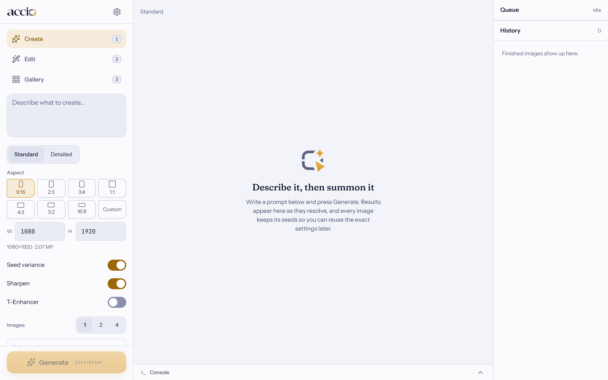
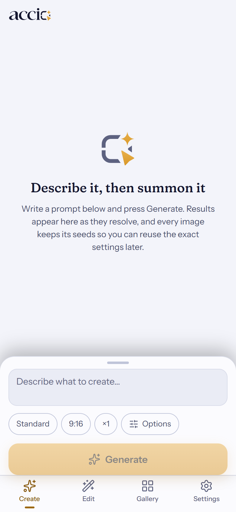

# Accio Studio

A web app for **image generation** (Krea 2) and **image editing** (Qwen Image Edit 2.1) that runs on your own PC.
It works on a computer, a phone and a tablet, and installs like an app. Everything stays on your machine unless you
choose to share it over a tunnel.

It ships with its own portable copy of ComfyUI as the engine. You never open ComfyUI yourself.

- **Create**: Standard (one pass) and Detailed (two passes with a refine step), with Seed Variance, T-Enhancer and Sharpen switches.
- **Edit**: Multi-edit (up to 9 images, head and body swap presets), Inpaint (paint a mask; remove or move an object) and Outpaint (drag the edges out).
- **Character sheet** (in Edit): upload one photo and get a sheet of face close-ups and a sheet of full-body views. *One by one* renders every angle at full quality and stitches them into a grid (slow: one render per view); *Merged* has the model draw each whole sheet in one picture (two renders, quicker, lower quality).
- **Gallery** of everything you made, with thumbnails, "Reuse settings" and "Send to Edit".

| Desktop | Mobile |
|---|---|
|  |  |

## What you need

| | |
|---|---|
| OS | Windows 10 or 11, 64-bit |
| GPU | **Nvidia**, RTX 20-series or newer recommended (the int8 models were tested on an RTX 2060 6 GB; it is slow there, about 3 to 4 minutes per Create job). Other GPUs: the installer warns and lets you continue, untested. Nvidia driver **580 or newer** for the default engine; with an older driver (525 or newer) the installer picks the CUDA 12.6 engine by itself, and RTX 50 series cards need 580+. |
| Disk | about **45 GB** free (37 GB of models, 5 GB for the engine, the rest for results) |
| Internet | for the install (models come from Hugging Face). Not needed afterwards unless you use a tunnel. |

You do **not** need to install Python, Node, Git, 7-Zip or ComfyUI. Nothing is installed system-wide: no admin rights, no PATH
changes. Everything lives in this folder, so deleting the folder uninstalls it.

## Install (once)

1. Unzip `AccioStudio-<version>.zip` into a **short folder path** with plenty of space, for example the root of `C:\` or `D:\`.
   The zip holds one folder, `AccioStudio`, so you end up with `C:\AccioStudio`.
   The path must be at most 100 characters and must not contain `!`: Windows cannot load some of the engine's files from a deeper
   folder, so `Install.bat` stops with a clear message instead. Avoid `C:\Program Files`. **Do not move or rename the folder
   afterwards** (if you do, run `Install.bat` again; it repairs the Python environment and keeps everything else).
2. Double-click **`Install.bat`** and wait. It is safe to close it and run it again later: it resumes and skips finished steps.
   It downloads the tools, the engine (ComfyUI 0.38.0) and 9 pinned custom-node packs. It does not download models.
3. Start Accio with `Run_Accio.bat`, open **Settings > Models** and download the models you want. Every file is checked when it
   finishes, and an interrupted download resumes. Already have the models from another ComfyUI? Point **Settings > Model folders**
   at them instead (they are only **read**, never changed, and nothing is copied). The four preset LoRAs (head swap, body swap,
   remove object, move object) and Flux2 Klein 9B (about 19 GB, a second Edit model that does Multi-edit with up to 3 images; pick
   it in Edit > Advanced > Model) are optional downloads there.

## Daily use

1. Double-click **`Run_Accio.bat`** and pick a connection mode (the default is 1):

   | | Mode | Use it for |
   |---|---|---|
   | 1 | Local only | this PC (`http://127.0.0.1:7862`) |
   | 2 | Cloudflare | reach it from your phone anywhere; a random `trycloudflare.com` address each time |
   | 3 | zrok | the same, with an address that stays the same (run **`Setup_Zrok.bat`** once first). `Run_Accio-zrok-only.bat` skips the menu. |
   | 4 | Same network | other devices on your Wi-Fi |
   | 5 | Tailscale | private: only devices signed into your own Tailscale account (needs the Tailscale app, and Serve enabled once on your tailnet) |

2. The browser opens. The **first time** you choose a password (at least 10 characters). On another device, or whenever a tunnel is
   running, the one-time setup code printed in the server window is needed too.
3. Scan the QR code in the window (or in Settings, under Connection) with your phone and sign in.
4. Install it as an app: "Install app" in the browser menu, or "Add to Home Screen" on iPhone. (Browsers only offer this over https or
   on `localhost`, so a plain-http Wi-Fi address cannot be installed; use a tunnel for that.)

The first job after starting takes longer: the models have to load into GPU memory.

**`Stop_Accio.bat`** stops the server, the engine and any tunnel this folder started, and nothing else.
**`Reset_Password.bat`** removes the password and signs every device out (use it if you forget it).

## Settings

The gear opens Settings: theme, connection (addresses and QR code), updates, model folders and a setup check. It also has a **This PC** card with your
graphics card and its memory, the driver, the CUDA version the driver supports and the one the engine was built for, and your RAM. CUDA rows say
"Not applicable" on a PC without an Nvidia card.

When an image size, an upscale or a megapixel slider is more than your graphics card handles comfortably, a short note appears under it. It is a
heads-up only: nothing is blocked. The limit follows your card's memory and drops a little under 16 GB of RAM. The notes need an Nvidia card; the
memory of AMD and Intel cards is not read.

## Updating

Settings (the gear) shows the installed version and tells you when a newer release exists. To install it:

- click **Update now** in Settings (only in the browser on the PC that runs Accio), or double-click **`Update.bat`**.

It downloads the new release, checks its SHA-256 and refuses it if it does not match, stops Accio, keeps a backup of the old
version in `data\backup\`, replaces only the app itself (`server\`, `installer\`, `frontend\dist\`, the `.bat` files, this README,
the licence) and then runs `Install.bat` for anything new. Your history, password, `settings.json` and models are never touched.
When it says Done, start Accio again with `Run_Accio.bat`. Close any other Accio window first.

- `Update.bat --check` only tells you whether an update exists. `--force` reinstalls the newest release.
- A release that also upgrades the ComfyUI engine is refused ("needs the full zip") so your models can never be put at risk.
  Download the full zip from the Releases page and follow the notes there.
- To go back, copy the files from `data\backup\<version>-<time>\` over the app folder.
- To stop Accio contacting GitHub, set `"check_updates": false` in `settings.json`.

## Where things are

```
Install.bat  Run_Accio.bat  Run_Accio-zrok-only.bat  Setup_Zrok.bat  Stop_Accio.bat  Reset_Password.bat
bin\        portable tools (uv, 7zr, Node when needed, cloudflared, zrok)
env\        Python environment of the Accio server
comfyui\    the engine: ComfyUI\ (with the models in ComfyUI\models\) and python_embeded\
server\     the Accio server and its prompt templates (templates\manifest.json lists every pinned version)
data\       your history, thumbnails, uploads and logs (data\logs\comfyui.log is the engine's log)
settings.json   optional settings (below). Holds your password hash once set; do not share it.
```

Results are also saved by the engine in `comfyui\ComfyUI\output\AccioStudio\`.
(Installs made by earlier builds keep working: their engine lives one level deeper, in `comfyui\ComfyUI_windows_portable\`.)

### Optional `settings.json`

Create it next to `Run_Accio.bat`. Unknown keys are ignored.

| Key | Default | Meaning |
|---|---|---|
| `port` | `7862` | the app's port |
| `lan_access` | `false` | listen on the network (same as menu option 4) |
| `session_days` | `14` | how long a login lasts |
| `max_upload_mb` | `40` | largest image you can upload |
| `auto_unload_minutes` | `0` (off) | free GPU memory after this many idle minutes |
| `check_updates` | `true` | look for a newer release on GitHub (Settings > Updates, `Update.bat`); `false` = never contact it |
| `comfy_port` | `8189` | the bundled engine's port (it listens on this PC only) |
| `external_comfy_url` | empty | advanced: use another ComfyUI instead of the bundled one (it is then not started) |

## Safety

- There is **no default password**. Sessions expire, signing out ends them, and changing the password signs out every other device.
- Failed logins are rate-limited. The app only accepts same-site requests and sets no permissive CORS headers.
- The engine is never exposed: it listens on `127.0.0.1` and the browser only talks to Accio.
- Over a tunnel, anyone who has the address can reach the **login page**, nothing else. Use a long password.
- By default the server listens on this PC only. Menu option 4 (or `lan_access`) opens it to your local network; the login still applies.

## Troubleshooting

| Problem | What to do |
|---|---|
| "The backend did not answer within 3 minutes" | open `data\logs\comfyui.log`; update the Nvidia driver (580 or newer); run `Install.bat` again |
| `Install.bat` says the Nvidia driver is too old | update the driver from nvidia.com/drivers, then run `Install.bat` again |
| Settings shows missing models or nodes | run `Install.bat` again, it downloads and verifies what is missing |
| `Install.bat` says the folder path is too long | move the whole folder closer to the drive root, e.g. `C:\AccioStudio`, and run it again |
| "The Python environment does not start" | the folder was moved or renamed; run `Install.bat`, it rebuilds the environment |
| A download is slow | `Install.bat` drops any connection slower than about 100 KB/s for 20 seconds and reconnects, continuing where it stopped (servers hand out connections of very different speed). You can also close the window and run `Install.bat` again at any time: finished files are kept and partial ones resume. If it ends with "download failed", just run it again. |
| "The backend ran out of GPU memory" | close other GPU programs, lower the size (the note under the size shows what your card handles comfortably), or use Standard instead of Detailed |
| A job seems stuck at "Waiting for the GPU" | another job is running in the engine; the queue pane shows it |
| Can't reach it from the phone | same Wi-Fi? choose option 4, and allow private networks if Windows Firewall asks |
| Forgot the password | `Reset_Password.bat` |

## Models and licences

Accio Studio itself is released under the MIT licence (see `LICENSE`). That covers this project only, not the models or the engine below.

Accio Studio does **not** include any model. `Install.bat` downloads them from their public mirrors, and **the licences of
Krea 2, Qwen Image, the VAEs and every LoRA are your responsibility**: read them before you use the results commercially.
ComfyUI (GPL-3.0) and the custom-node packs are downloaded from their own repositories at pinned versions and keep their own licences.

## For developers

**Publishing a release** (users update from these):

1. Commit everything, then run `scripts\make_release.bat` and choose Patch / Minor / Major. It runs the tests, builds the
   frontend, writes `release\AccioStudio-<version>.zip` and its `.sha256`, and commits and tags `vX.Y.Z`.
2. `git push --follow-tags`.
3. On GitHub: Releases > Draft a new release > choose the tag `vX.Y.Z` > attach **both** `AccioStudio-<version>.zip` and
   `AccioStudio-<version>.zip.sha256` > Publish. The updater looks at the *latest published* release (not drafts or pre-releases) and
   will not install one that has no checksum.
4. If the release changes the ComfyUI version, say so in the notes: the updater refuses those and users must take the full zip.

```powershell
env\Scripts\python.exe -m pytest tests -q          # backend tests (live ones need the bundled engine running)
cd frontend; npm test; npm run build               # frontend tests and production build into frontend\dist
node scripts\check-contrast.mjs                    # design-token contrast check
scripts\make_release.bat                           # menu: patch / minor / major / rebuild. Runs the tests, builds the frontend, writes release\AccioStudio-<version>.zip + .sha256, then commits and tags "Release vX.Y.Z" (nothing is pushed)
scripts\make_release.bat --bump patch              # the same without the menu (also --version X.Y.Z; --allow-dirty, --skip-tests, --no-build)
env\Scripts\python.exe scripts\parity_gpu.py --help   # GPU pixel-parity runs against a reference ComfyUI
```

- `APP_SPEC.md` is the build spec and `PROGRESS.md` the build log (decisions, results, known gaps).
- The prompt templates in `server\templates\` are exported by ComfyUI's own frontend, never edited by hand.
  After changing a workflow or updating ComfyUI or a node pack, re-export them (`scripts\export-templates.md`) and re-run the parity tests.
- The release zip contains only the launchers, the server, installer and templates, the built frontend, this README and the licence.
  It never contains models, `env\`, `bin\`, `comfyui\`, `data\`, `settings.json` or `.zrok_share`.
